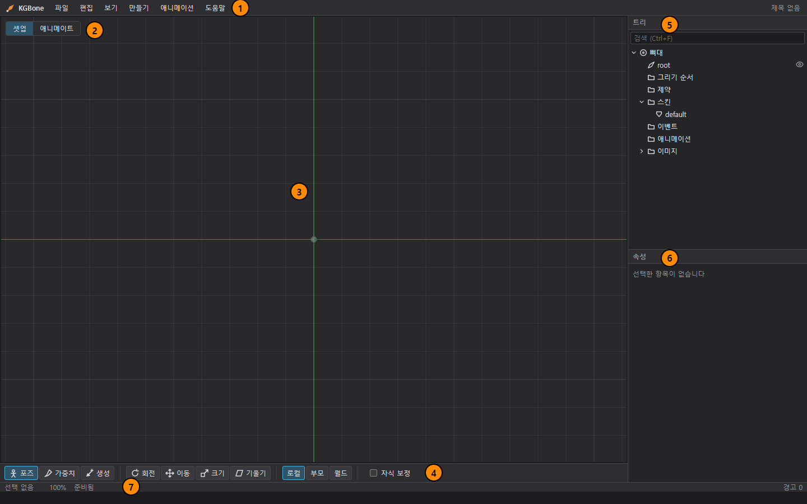
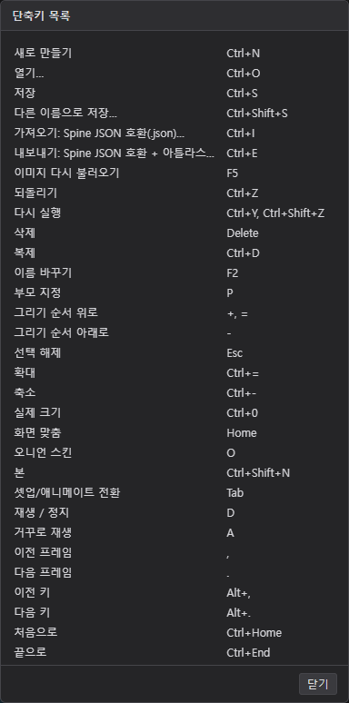

# 1. 설치와 화면 구성

[← 차례](README.md) · [다음: 2. 첫 캐릭터 만들기 →](02-first-character.md)

## 1-1. 설치

KGBone은 브라우저에서 돌아가는 웹 앱입니다. 설치하면 일반 프로그램처럼 시작 메뉴에서 열리고, 인터넷 없이도 실행됩니다.

1. **Microsoft Edge**로 https://dudwo2199.github.io/KGBone/ 을 엽니다.
2. 주소창 오른쪽의 **앱 설치** 아이콘(또는 `…` 메뉴 → **앱** → **이 사이트를 앱으로 설치**)을 누릅니다.
3. 설치가 끝나면 시작 메뉴에 **KGBone**이 생깁니다. 이제부터는 이것으로 엽니다.

> **Chrome도 되나요?** 열고 편집하는 것은 Chrome도 됩니다. 다만 Windows판 Chrome으로 설치하면 `.kgbone` 파일의 아이콘이 비어 보입니다. 파일 아이콘까지 보려면 Edge로 설치하세요.

### `.kgbone` 파일을 더블클릭으로 열기

Edge로 설치하면 `.kgbone` 파일이 KGBone에 연결됩니다. 처음 더블클릭할 때 Windows가 어떤 앱으로 열지 물으면 **KGBone**을 고르고 **항상**을 누르세요.

### 파일 접근 허용

KGBone은 내 PC의 실제 파일을 직접 열고 저장합니다. 처음 저장하거나 폴더를 고를 때 브라우저가 **"파일 편집을 허용할까요?"** 하고 물으면 허용합니다.

파일을 열 때 **프로젝트 폴더 고르기** 창이 뜨면, 그 `.kgbone` 파일이 들어 있는 폴더를 고릅니다. 그래야 옆에 있는 이미지 폴더까지 함께 읽을 수 있습니다(자세한 이유는 [7장](07-files-export.md#7-2-이미지-폴더)).

## 1-2. 화면 구성

| 번호 | 이름 | 하는 일 |
|---|---|---|
| 1 | **메뉴 막대** | 파일·편집·보기·만들기·애니메이션·도움말. 오른쪽 끝에 문서 이름이 보이고, 저장하지 않은 변경이 있으면 이름 뒤에 `*`가 붙습니다 |
| 2 | **모드 전환** | **셋업**(캐릭터의 기본 모습 만들기)과 **애니메이트**(움직임 만들기)를 바꿉니다. 단축키 **Tab** |
| 3 | **뷰포트** | 캐릭터가 보이는 작업 공간. 가운데 초록 세로선과 흰 가로선이 만나는 곳이 원점(0, 0)입니다 |
| 4 | **도구 모음** | 포즈·가중치·생성 도구, 회전·이동·크기·기울기 도구, 축(로컬·부모·월드), 자식 보정 |
| 5 | **트리** | 뼈대의 모든 항목(본, 슬롯, 첨부물, 제약, 스킨, 이벤트, 애니메이션, 이미지)이 나무 모양으로 보입니다 |
| 6 | **속성** | 트리나 뷰포트에서 고른 항목의 값을 보고 고칩니다 |
| 7 | **상태 표시줄** | 고른 항목, 확대 비율, 진행 상태(준비됨·재생 중), 오른쪽 끝에 경고 수 |

애니메이트 모드로 바꾸면 아래쪽에 **재생 막대**와 **도프시트/그래프**가 열리고, 뷰포트 테두리가 주황색이 됩니다([3장](03-animation.md)).

## 1-3. 기본 용어

| 용어 | 뜻 |
|---|---|
| **뼈대**(skeleton) | 캐릭터 하나 전체. 프로젝트 파일 하나에 뼈대 하나가 들어 있습니다 |
| **본**(bone) | 뼈. 부모-자식으로 이어지며, 부모가 움직이면 자식도 따라 움직입니다. 맨 위 본은 `root`입니다 |
| **슬롯**(slot) | 본에 붙은 "그림 꽂이". 그리기 순서와 색을 가집니다 |
| **첨부물**(attachment) | 슬롯에 꽂는 실제 내용. 이미지, 메시, 바운딩 박스, 포인트, 클리핑, 패스가 있습니다 |
| **셋업 포즈** | 애니메이션이 없을 때의 기본 모습. 모든 애니메이션은 셋업 포즈에서 얼마나 바뀌는지를 기록합니다 |
| **키**(key) | 어떤 시점의 값. 키와 키 사이는 자동으로 채워집니다(보간) |

본 하나에 슬롯을 여러 개, 슬롯 하나에 첨부물을 여러 개 둘 수 있습니다. 슬롯에는 한 번에 첨부물 하나만 보입니다(예: 눈 슬롯에 "뜬 눈"과 "감은 눈" 첨부물을 넣고 바꿔 보여 줌).

## 1-4. 뷰포트 조작

| 조작 | 동작 |
|---|---|
| 마우스 휠 | 확대·축소(커서 위치 기준) |
| 가운데 버튼 끌기, 또는 **Space**를 누른 채 왼쪽 끌기 | 화면 이동 |
| **Home** | 캐릭터가 화면에 꽉 차게 맞춤 |
| **Ctrl+0** | 실제 크기(100%) |
| 왼쪽 클릭 | 본이나 그림 고르기. **Ctrl** 또는 **Shift**를 누르고 클릭하면 여러 개 고르기 |
| 오른쪽 클릭 | 지금 도구와 직전 도구를 맞바꾸기(예: 이동 ↔ 회전) |
| **Esc** | 선택 해제 |

본은 회색 마름모 모양으로 그려지고, 고른 본은 하늘색이 됩니다. **보기 → 본 표시 / 이미지 표시**로 본이나 그림을 숨길 수 있습니다.

## 1-5. 되돌리기

모든 편집은 **Ctrl+Z**(되돌리기)와 **Ctrl+Y** 또는 **Ctrl+Shift+Z**(다시 실행)로 오갈 수 있습니다. 마우스로 한 번 끈 것은 아무리 길게 끌어도 되돌리기 한 번입니다.

## 1-6. 단축키 목록 보기

**F1**(도움말 → 단축키 목록)을 누르면 모든 단축키가 나옵니다. 전체 표는 [8장](08-reference.md)에도 있습니다.

---
[← 차례](README.md) · [다음: 2. 첫 캐릭터 만들기 →](02-first-character.md)
