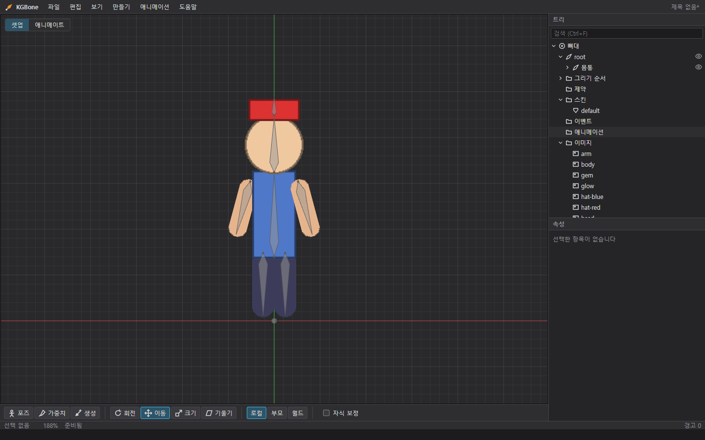
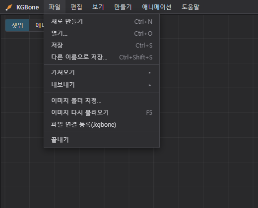
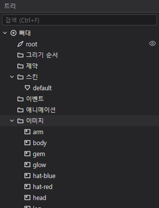
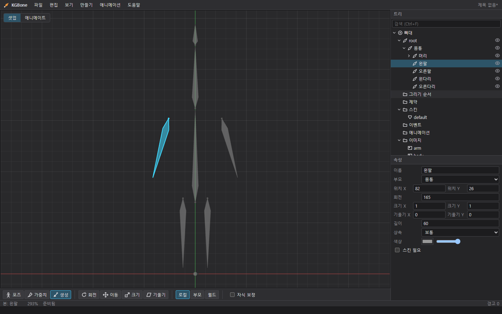
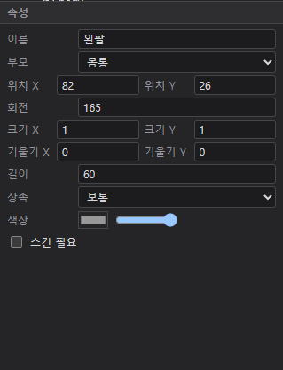
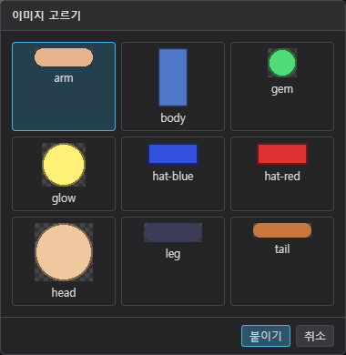
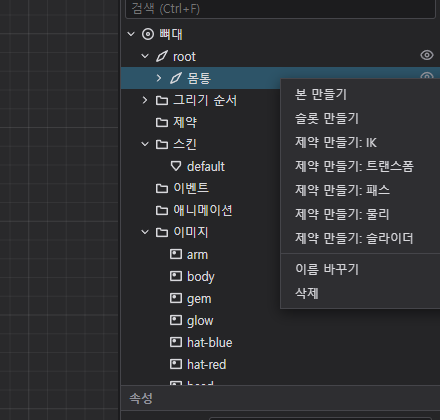
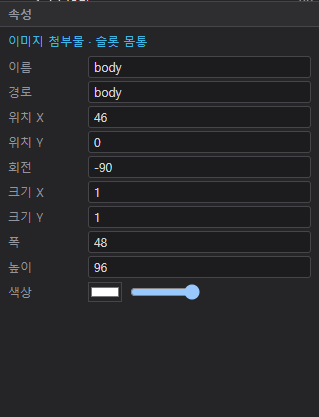
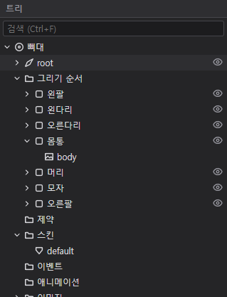
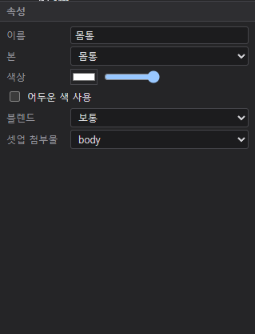

# 2. 첫 캐릭터 만들기

[← 1. 설치와 화면 구성](01-start.md) · [차례](README.md) · [다음: 3. 애니메이션 →](03-animation.md)

이 장에서는 아래 인형을 처음부터 만듭니다. 머리·몸통·팔·다리·모자 그림 6장과 본 8개로 되어 있습니다.



## 2-1. 프로젝트 폴더 준비

먼저 그림 파츠를 **파츠마다 한 장씩 PNG**(배경 투명)로 준비합니다. 그리고 아래처럼 폴더를 만듭니다.

```
인형/
  인형.kgbone      ← 앞으로 만들 프로젝트 파일
  images/          ← 파츠 PNG를 여기에
    head.png
    body.png
    arm.png
    leg.png
    hat-red.png
    hat-blue.png
```

- 이미지 이름(확장자 뺀 부분)이 KGBone 안에서 그림의 이름이 됩니다. `images/옷/윗옷.png`처럼 하위 폴더에 넣으면 이름은 `옷/윗옷`이 됩니다.
- 한글 이름도 됩니다.

> 예제 그림은 저장소의 `samples/images` 폴더에 있습니다. 직접 해 보려면 이 PNG들을 `images/`에 복사하세요.

## 2-2. 새 프로젝트 만들고 바로 저장하기



1. **파일 → 새로 만들기**(Ctrl+N).
2. 곧바로 **파일 → 다른 이름으로 저장**(Ctrl+Shift+S)을 눌러 `인형` 폴더에 `인형.kgbone`으로 저장합니다.
3. 저장하면 프로젝트 파일 옆의 `images` 폴더를 자동으로 읽습니다. 트리의 **이미지** 폴더를 펼치면 그림 목록이 보입니다.



처음에 저장하는 이유: 이미지 폴더는 **프로젝트 파일이 있는 곳을 기준**으로 찾기 때문입니다(기본값 `./images`). 다른 폴더의 그림을 쓰려면 **파일 → 이미지 폴더 지정**으로 고르세요. 그림 파일을 고친 뒤에는 **F5**(이미지 다시 불러오기)를 누르면 바로 반영됩니다.

## 2-3. 본 만들기

### 생성 도구로 그리기

1. 도구 모음에서 **생성**(N)을 고릅니다.
2. 부모가 될 본을 클릭해 고릅니다. 처음에는 `root`를 고르면 됩니다(트리에서 클릭해도 됩니다).
3. 뷰포트의 **빈 곳**에서 본이 시작할 점부터 끝날 점까지 끕니다. 고른 본의 자식으로 새 본이 생기고, 새 본이 선택됩니다.
4. 그 상태로 다시 끌면 방금 만든 본의 자식이 이어서 생깁니다. 팔·꼬리처럼 사슬을 만들 때 편합니다.

- 끌지 않고 클릭만 하면 길이 0인 본(점)이 생깁니다.
- 생성 도구로 **본 위**를 클릭하면 새 본을 만들지 않고 그 본을 고릅니다. 다른 부모 아래에 만들고 싶으면 그 본을 먼저 클릭하세요.
- **만들기 → 본**(Ctrl+Shift+N)은 고른 본 위치에 자식 본을 바로 만듭니다. 값은 속성 패널에서 입력합니다.



### 예제 인형의 본

정확한 값은 속성 패널에 입력하면 됩니다. 각도는 도이고, 반시계 방향이 +입니다. 위치는 **부모 본 기준**입니다. 본의 X축은 본이 뻗은 방향이므로, 위를 향한 `몸통`의 자식은 X가 "위쪽", Y가 "왼쪽"입니다.

| 본 | 부모 | 위치 X | 위치 Y | 회전 | 길이 |
|---|---|---|---|---|---|
| 몸통 | root | 0 | 70 | 90 | 90 |
| 머리 | 몸통 | 92 | 0 | 0 | 60 |
| 모자 | 머리 | 62 | 0 | 0 | 20 |
| 왼팔 | 몸통 | 82 | 26 | 165 | 60 |
| 오른팔 | 몸통 | 82 | -26 | -165 | 60 |
| 왼다리 | 몸통 | 4 | 12 | 180 | 68 |
| 오른다리 | 몸통 | 4 | -12 | 180 | 68 |

### 이름 바꾸기

트리에서 본을 **더블클릭**하거나 **F2**, 또는 속성 패널의 **이름** 칸에서 바꿉니다. 한글 이름을 쓸 수 있습니다.

### 부모 바꾸기

- 트리에서 본을 끌어 새 부모 위에 놓습니다.
- 또는 본을 고르고 **P**(편집 → 부모 지정)를 누른 뒤 뷰포트에서 새 부모 본을 클릭합니다(Esc로 취소).
- 속성 패널의 **부모** 목록에서 골라도 됩니다.

### 본 속성



| 항목 | 뜻 |
|---|---|
| 부모 | 부모 본 |
| 위치 X / Y | 부모 본 기준 위치 |
| 회전 | 부모 본 기준 각도(도) |
| 크기 X / Y | 배율. X는 본 방향, Y는 그와 직각 방향. 음수면 뒤집힘 |
| 기울기 X / Y | 비스듬히 기울이기(도) |
| 길이 | 본의 길이(그림에는 영향 없음, 표시와 IK 계산에 씀) |
| 상속 | 부모에게서 무엇을 물려받을지. **보통**(전부), **이동만**, **회전·반사 없음**, **크기 없음**, **크기·반사 없음** |
| 색상 | 뷰포트에서 본을 그리는 색 |
| 스킨 필요 | 켜면 이 본을 넣은 스킨이 켜졌을 때만 본이 동작합니다([6장](06-skins-events.md)) |

## 2-4. 슬롯 만들고 그림 붙이기

그림은 **본 → 슬롯 → 첨부물** 순서로 붙습니다.

1. 그림을 붙일 본(예: `머리`)을 고릅니다.
2. **만들기 → 슬롯**. 그 본 아래에 슬롯이 생깁니다. 이름을 `머리`처럼 알아보기 쉽게 바꿉니다(F2).
3. 슬롯을 고른 채 **만들기 → 첨부물 → 이미지**. 이미지 고르기 창에서 그림을 고르고 **붙이기**를 누릅니다.



첨부물은 처음에 본의 원점(시작점)에 그림 크기 그대로 놓입니다. 트리에서 슬롯을 오른쪽 클릭 → **첨부물 만들기: 이미지**로도 같은 창이 열립니다.



트리에서 항목을 오른쪽 클릭하면 그 항목에서 할 수 있는 일(본·슬롯·첨부물·제약 만들기, 이름 바꾸기, 삭제 등)이 나옵니다. 위 그림은 본을 오른쪽 클릭한 모습입니다.

## 2-5. 그림 위치 맞추기

### 뷰포트에서 끌기

셋업 모드에서 **이동**(V) 도구로 **그림**을 잡고 끌면, 본은 그대로 두고 그 그림(첨부물)만 옮겨집니다. **본**을 잡고 끌면 본째로 옮겨집니다.

- **Shift**를 누른 채 끌면 한 방향으로만 움직입니다(축 설정 기준).
- Ctrl 또는 Shift를 누르고 **클릭**하면 옮기지 않고 선택만 합니다.
- 끌어서 옮기기는 **이미지 첨부물**만, **셋업 모드**에서만 됩니다. 그림을 돌리거나 키울 때는 속성 패널 숫자를 씁니다.

### 속성 패널에 입력하기



| 항목 | 뜻 |
|---|---|
| 경로 | 쓸 그림 이름. 첨부물 이름과 다른 그림을 쓰고 싶을 때 바꿉니다 |
| 위치 X / Y, 회전, 크기 X / Y | **본 기준**으로 그림을 놓는 위치·각도·배율 |
| 폭 / 높이 | 화면에 그릴 크기. 처음엔 그림 픽셀 크기와 같습니다 |
| 색상 | 그림에 곱할 색과 투명도 |

예제 인형의 첨부물 값(폭·높이는 그림 크기 그대로):

| 슬롯 | 그림 | 위치 X | 회전 |
|---|---|---|---|
| 몸통 | body | 46 | -90 |
| 머리 | head | 30 | -90 |
| 모자 | hat-red | 6 | -90 |
| 왼팔, 오른팔 | arm | 30 | 0 |
| 왼다리, 오른다리 | leg | 34 | 0 |

`몸통`·`머리`·`모자` 본은 위를 향하므로(회전 90), 가로로 그려진 그림이 아니라면 첨부물을 -90도 돌려 세웁니다.

## 2-6. 그리기 순서

트리의 **그리기 순서** 폴더에 모든 슬롯이 그려지는 순서대로 있습니다. **목록 위쪽이 먼저(뒤에) 그려지고, 아래쪽일수록 앞에** 보입니다.



순서를 바꾸는 방법:

- 트리에서 슬롯을 끌어 원하는 자리에 놓기.
- 슬롯을 고르고 **+**(앞으로, 목록에서는 한 칸 아래로) 또는 **-**(뒤로, 목록에서는 한 칸 위로).

예제 인형은 `왼팔 → 왼다리 → 오른다리 → 몸통 → 머리 → 모자 → 오른팔` 순서입니다. 왼팔은 몸 뒤에, 오른팔은 몸 앞에 보입니다.

애니메이트 모드에서 순서를 바꾸면 그 시점에 **그리기 순서 키**가 생깁니다(예: 돌아설 때 팔이 몸 앞으로 나오게).

## 2-7. 슬롯 속성



| 항목 | 뜻 |
|---|---|
| 본 | 슬롯이 붙은 본(바꿀 수 있음) |
| 색상 | 슬롯의 모든 그림에 곱할 색과 투명도. 애니메이션으로 깜빡이거나 사라지게 할 때 씁니다 |
| 어두운 색 사용 / 어두운 색 | 그림의 어두운 부분을 물들이는 색(tint black). 그림자 색을 바꿀 때 씁니다 |
| 블렌드 | 겹칠 때 섞는 방식. **보통**, **더하기**(빛·불꽃), **곱하기**(그림자), **스크린**(밝게) |
| 셋업 첨부물 | 셋업 포즈에서 보일 첨부물. **(없음)**이면 아무것도 안 보입니다 |

## 2-8. 본 움직이기: 변환 도구

셋업 모드에서 본을 움직이면 캐릭터의 기본 모습이 바뀌고, 애니메이트 모드에서 움직이면 애니메이션 키가 생깁니다.

| 도구 | 키 | 끌면 | Shift를 누르고 끌면 |
|---|---|---|---|
| 회전 | C | 본 원점을 중심으로 돌림 | 15도 단위로 |
| 이동 | V | 본을 옮김(그림을 잡으면 그림만, 2-5) | 한 방향으로만 |
| 크기 | X | 본 원점 기준으로 늘이고 줄임 | X·Y 같은 비율로 |
| 기울기 | Z | 비스듬히 기울임 | 15도 단위로 |
| 포즈 | B | 본 끝이 커서를 향하게 돌림 | — |

- 본을 여러 개 고르고(Ctrl+클릭) 끌면 함께 움직입니다.
- **축**: 이동·크기의 방향 기준을 고릅니다. **로컬**(본 자신의 방향), **부모**(부모 본 방향), **월드**(화면 가로·세로). 고른 본에 축 화살표가 표시됩니다.
- **자식 보정**: 켜면 셋업 모드에서 본을 움직여도 직계 자식 본은 화면상 제자리에 남습니다. 뼈대 구조를 다듬을 때 씁니다.

## 2-9. 저장

**Ctrl+S**로 저장합니다. 저장하지 않은 변경이 있으면 제목 뒤에 `*`가 붙고, 새로 만들기·열기·닫기 전에 저장할지 묻습니다.

`.kgbone`에는 뼈대와 애니메이션, 그리고 작업 상태(고른 애니메이션, 화면 위치, 모드 등)가 함께 저장됩니다. 그림은 들어가지 않고 이미지 폴더를 가리키기만 하므로, 프로젝트를 옮길 때는 **`images` 폴더도 함께** 옮기세요.

---
[← 1. 설치와 화면 구성](01-start.md) · [차례](README.md) · [다음: 3. 애니메이션 →](03-animation.md)
