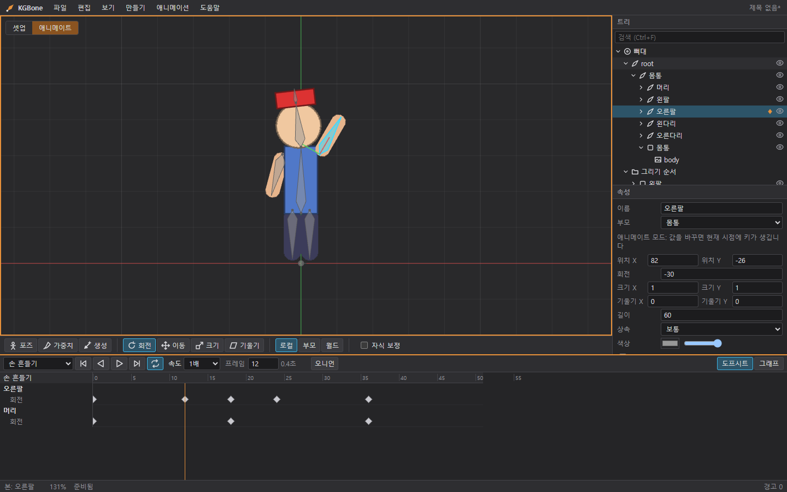
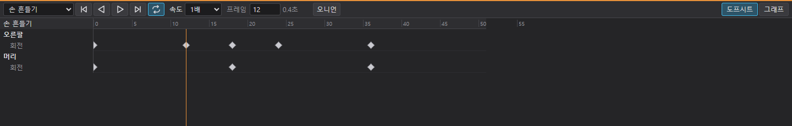
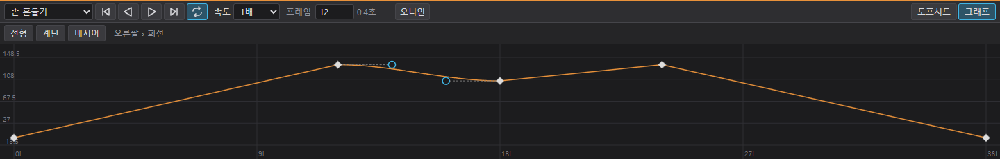
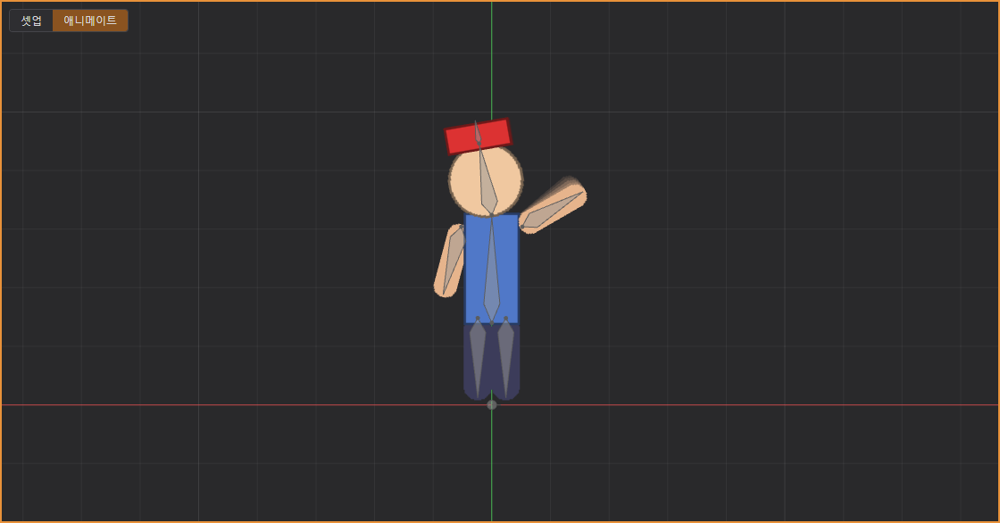
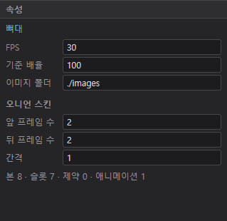

# 3. 애니메이션

[← 2. 첫 캐릭터 만들기](02-first-character.md) · [차례](README.md) · [다음: 4. 메시와 가중치 →](04-mesh.md)

2장에서 만든 인형으로 오른손을 흔드는 애니메이션을 만듭니다.

## 3-1. 셋업 모드와 애니메이트 모드

| | 셋업 모드 | 애니메이트 모드 |
|---|---|---|
| 하는 일 | 캐릭터의 기본 모습(셋업 포즈)을 만든다 | 시간에 따른 움직임(키)을 만든다 |
| 본을 움직이면 | 기본 모습이 바뀐다 | 지금 시점에 키가 생긴다 |
| 화면 | 기본 | 아래에 재생 막대·도프시트가 열리고, 뷰포트 테두리가 주황색 |

**Tab** 또는 뷰포트 왼쪽 위의 **셋업 / 애니메이트** 버튼으로 바꿉니다.

> 애니메이션은 셋업 포즈에서 **얼마나 바뀌었는지**를 기록합니다. 셋업 포즈를 나중에 고치면 모든 애니메이션에 함께 반영됩니다.

## 3-2. 애니메이션 만들기

1. **만들기 → 애니메이션**. 새 애니메이션이 생기고 바로 선택됩니다.
2. 트리의 **애니메이션** 폴더에서 이름을 `손 흔들기`로 바꿉니다(F2).
3. **Tab**으로 애니메이트 모드로 갑니다.

애니메이션이 여러 개면 재생 막대 왼쪽의 목록이나, 트리에서 애니메이션을 오른쪽 클릭 → **이 애니메이션 고르기**로 바꿉니다. 애니메이션을 고르고 **Ctrl+D**를 누르면 복제됩니다.

## 3-3. 키 만들기

애니메이트 모드에서는 **값을 바꾸면 지금 시점에 키가 자동으로 생깁니다.** 도구로 본을 끌어도, 속성 패널에 숫자를 입력해도 됩니다.

예제(30fps 기준):

1. 시점을 **0프레임**에 두고 `오른팔`을 고른 뒤 속성 패널의 **회전**에 `-165`를 입력합니다(지금 값 그대로 키를 넣고 싶으면 **K**).
2. 재생 막대의 **프레임** 칸에 `12`를 입력하고 Enter. 회전 도구(C)로 팔을 들어 올립니다(회전 `-30`).
3. `18`프레임: 회전 `-60`.
4. `24`프레임: 회전 `-30`.
5. `36`프레임: 회전 `-165`(처음 자세로).
6. `머리`도 0프레임 `0`, 18프레임 `10`, 36프레임 `0`으로 살짝 기울입니다.

### 키 지정 명령

| 키 | 명령 | 하는 일 |
|---|---|---|
| **K** | 바뀐 값 키 지정 | 고른 본의 이동·회전·크기·기울기, 고른 슬롯의 색·첨부물을 **지금 보이는 값 그대로** 키로 넣습니다. 값을 바꾸지 않고 "이 자세를 여기서 유지"하고 싶을 때 씁니다 |
| **Ctrl+Shift+L** | 전부 키 지정 | 모든 본의 지금 값을 키로 넣습니다 |
| **Shift+K** | 제약 적용 값 키 지정 | IK 같은 제약이 만든 결과 자세를 그대로 본의 키로 굽습니다([5장](05-constraints.md)) |

### 키가 되는 것

- **본**: 이동, 회전, 크기, 기울기, 상속 방식
- **슬롯**: 색(투명도 포함), 어두운 색, 보이는 첨부물. 슬롯 속성의 **셋업 첨부물** 대신 애니메이트 모드에서 고르는 첨부물이 키가 됩니다(눈 깜빡임, 입 모양)
- **그리기 순서**: 애니메이트 모드에서 +/-나 트리 끌기로 순서를 바꾸면 키가 됩니다
- **메시 변형**: 애니메이트 모드에서 메시 정점을 옮기면 변형 키가 됩니다([4장](04-mesh.md))
- **제약 값**: 혼합 비율 등([5장](05-constraints.md))
- **이벤트**: [6장](06-skins-events.md)

트리에서 지금 시점에 키가 있는 본·슬롯·제약 옆에는 주황색 마름모가 표시됩니다.

## 3-4. 재생 막대

왼쪽부터:

| 항목 | 뜻 |
|---|---|
| 애니메이션 목록 | 편집·재생할 애니메이션 |
| ⏮ 처음 | 0초로(Ctrl+Home) |
| ◁ 거꾸로 재생 | (A) |
| ▷ 재생 / 정지 | (D) |
| ⏭ 끝 | 마지막 키로(Ctrl+End) |
| 반복 | 켜면 끝에서 처음으로 이어 재생 |
| 속도 | 0.1배 ~ 4배 |
| 프레임 / 초 | 지금 시점. 프레임 칸에 숫자를 넣어 이동합니다 |
| 오니언 | 오니언 스킨 켜기/끄기(O) |
| 도프시트 / 그래프 | 아래 영역의 보기 바꾸기 |

시점은 **,** / **.**(이전·다음 프레임), **Alt+,** / **Alt+.**(이전·다음 키)로도 옮깁니다.

애니메이션의 길이는 **마지막 키의 시점**입니다. 트리에서 애니메이션을 고르면 속성 패널에 길이(초·프레임)가 나옵니다.

## 3-5. 도프시트

도프시트는 키를 마름모로 보여 줍니다. 왼쪽은 본·슬롯 이름과 그 아래 타임라인(회전, 이동 …), 위쪽 눈금은 프레임입니다.

| 조작 | 동작 |
|---|---|
| 눈금 클릭 | 그 시점으로 이동 |
| 키 클릭 | 키 고르기. **Shift** 또는 **Ctrl**+클릭으로 여러 개 |
| 고른 키 끌기 | 시점 옮기기(프레임 단위) |
| **Delete** | 고른 키 삭제(도프시트에 초점이 있을 때) |
| **Ctrl+C** / **Ctrl+V** | 고른 키 복사 / 지금 시점에 붙여넣기 |
| 빈 곳 클릭 | 키 선택 해제 |
| 타임라인 이름 클릭 | 그래프에 보일 타임라인 고르기 |

## 3-6. 보간과 그래프

키와 키 사이를 어떻게 채울지를 **보간**이라고 합니다.

| 보간 | 움직임 |
|---|---|
| **선형** | 일정한 속도로 |
| **계단** | 다음 키까지 값을 유지하다가 한 번에 바뀜(눈 깜빡임, 첨부물 바꾸기) |
| **베지어** | 곡선으로 가속·감속 |

도프시트에서 키를 고르고 **애니메이션 → 보간** 메뉴나 그래프 위쪽의 **선형 / 계단 / 베지어** 버튼으로 바꿉니다. 고른 키에서 **다음 키까지의 구간**에 적용됩니다.

**그래프** 탭은 고른 타임라인의 값을 곡선으로 보여 줍니다. 베지어 구간의 하늘색 동그라미(손잡이)를 끌어 가속·감속 모양을 다듬습니다. 이동·크기처럼 값이 둘(X, Y)인 타임라인은 **채널** 목록에서 고릅니다.

> 그래프의 값은 셋업 포즈에서 **바뀐 양**입니다. 위 그림의 오른팔 회전은 셋업 값(-165도)과의 차이라서 0 ~ 135 사이로 보입니다.

## 3-7. 오니언 스킨

**O**를 누르면 앞뒤 프레임의 자세가 반투명하게 겹쳐 보입니다. 앞(지난) 프레임은 붉은색, 뒤(다음) 프레임은 푸른색입니다. 움직임의 흐름과 간격을 확인할 때 씁니다.

보여 줄 프레임 수와 간격은 트리의 **뼈대**를 고르고 속성 패널의 **오니언 스킨**에서 정합니다.

## 3-8. 뼈대 속성(FPS)

| 항목 | 뜻 |
|---|---|
| FPS | 1초에 몇 프레임인지(기본 30). 도프시트 눈금과 프레임 이동의 단위입니다 |
| 기준 배율 | 물리 제약의 거리 단위 기준(기본 100) |
| 이미지 폴더 | 프로젝트 파일 기준 이미지 폴더 경로(기본 `./images`) |
| 오니언 스킨 | 앞 프레임 수, 뒤 프레임 수, 간격 |

---
[← 2. 첫 캐릭터 만들기](02-first-character.md) · [차례](README.md) · [다음: 4. 메시와 가중치 →](04-mesh.md)
