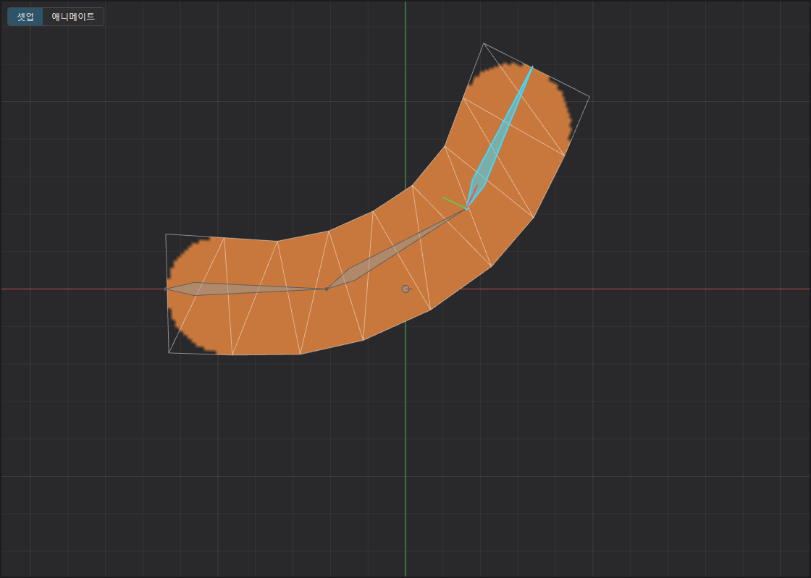
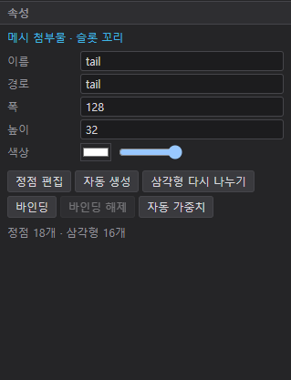
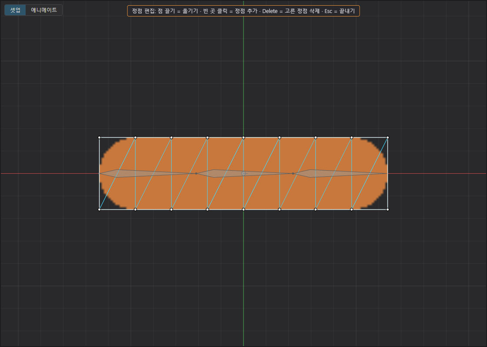

# 4. 메시와 가중치

[← 3. 애니메이션](03-animation.md) · [차례](README.md) · [다음: 5. 제약 →](05-constraints.md)

이미지 첨부물은 사각형 그대로 움직입니다. 꼬리·머리카락·옷자락처럼 **그림이 휘어야** 할 때는 **메시**를 씁니다. 메시는 그림을 삼각형 그물로 나누고, 그물의 점(정점)을 본에 묶어 본을 따라 휘게 합니다.

이 장의 예제는 꼬리 그림(`tail.png`) 하나를 본 세 개(`꼬리1` → `꼬리2` → `꼬리3`)로 휘게 하는 것입니다.

## 4-1. 메시 첨부물 만들기

1. 슬롯을 고릅니다.
2. **만들기 → 첨부물 → 메시** → 그림을 고르고 **붙이기**.
3. 트리에서 새 메시 첨부물을 고르면 속성 패널에 메시 작업 버튼이 나옵니다.

| 버튼 | 하는 일 |
|---|---|
| **정점 편집** | 뷰포트에서 정점을 끌고, 추가하고, 지우는 모드를 켜고 끕니다 |
| **자동 생성** | 그림의 투명하지 않은 부분을 따라 외곽선 정점을 자동으로 만듭니다 |
| **삼각형 다시 나누기** | 지금 정점으로 삼각형을 새로 나눕니다 |
| **바인딩** | 함께 고른 본들에 정점을 묶습니다(가중치 메시가 됨) |
| **바인딩 해제** | 본 묶음을 풀고 일반 메시로 돌립니다 |
| **자동 가중치** | 정점마다 본까지의 거리로 가중치를 계산합니다 |

아래쪽에 정점 수, 삼각형 수, 가중치 여부가 표시됩니다.

## 4-2. 정점 편집

**정점 편집**을 누르면 뷰포트 위에 안내가 뜨고, 정점이 흰 점으로 보입니다.

| 조작 | 동작 |
|---|---|
| 정점 끌기 | 옮기기 |
| **Shift** 또는 **Ctrl**+클릭 | 정점 여러 개 고르기(함께 끌기) |
| 빈 곳 클릭 | 가장 가까운 외곽선에 정점 추가(삼각형도 다시 나눔) |
| **Delete** | 고른 정점 삭제 |
| **Esc** | 정점 편집 끝내기 |

- 휘게 만들 곳에는 정점을 **촘촘히** 둡니다. 위 예제는 꼬리를 가로로 8칸으로 나눠 위아래 18개 정점을 두었습니다. 정점이 양 끝에만 있으면 본을 굽혀도 그림이 휘지 않고 찌그러집니다.
- 바인딩한 메시(가중치 메시)는 정점 수를 바꿀 수 없습니다. 먼저 **바인딩 해제**를 하세요.
- 애니메이트 모드에서 정점을 끌면 **메시 변형 키**가 생깁니다(정점 추가·삭제는 안 됨). 표정·옷 주름처럼 본 없이 모양을 바꿀 때 씁니다.

## 4-3. 바인딩과 자동 가중치

**가중치**는 "이 정점이 어느 본을 얼마나 따라가는가"입니다. 꼬리 가운데 정점이 `꼬리1` 50%, `꼬리2` 50%를 따라가면, 두 본 사이에서 부드럽게 휩니다.

1. 트리에서 메시 첨부물을 고릅니다.
2. **Ctrl**을 누른 채 묶을 본들(`꼬리1`, `꼬리2`, `꼬리3`)을 클릭합니다(트리 또는 뷰포트).
3. 속성 패널의 **바인딩**을 누릅니다.
4. **자동 가중치**를 누릅니다.

이제 본을 돌리면 그림이 따라 휩니다(맨 위 그림). 메시는 아무 본의 슬롯에 있어도 되지만, 바인딩한 뒤에는 슬롯의 본이 아니라 **묶은 본들**을 따라 움직입니다.

## 4-4. 가중치 붓

자동 가중치가 마음에 들지 않는 곳은 붓으로 칠해 고칩니다.

1. 트리에서 메시 첨부물을 고르고, **Ctrl**+클릭으로 칠할 본 하나를 함께 고릅니다.
2. 도구 모음의 **가중치**(G)를 고릅니다.
3. 뷰포트에서 끌면 붓 안의 정점이 그 본을 **더 많이** 따라가게 됩니다. **Alt**를 누르고 끌면 **덜** 따라가게 됩니다.

- 붓 크기는 화면에서 반지름 30픽셀로 일정합니다. 넓게 칠하려면 화면을 축소하고, 세밀하게 칠하려면 확대하세요.
- 한 번 지나갈 때마다 조금씩(10%) 바뀝니다. 여러 번 덧칠합니다.
- 끈 한 번이 되돌리기 한 번입니다.
- 지금은 가중치를 색으로 보여 주는 표시가 없습니다. 본을 돌려 보며 확인하세요.

## 4-5. 링크드 메시

**링크드 메시**는 다른 메시의 정점·삼각형·가중치를 그대로 빌려 쓰고 그림만 바꾼 메시입니다. 같은 모양의 옷을 색만 다르게 여러 벌 만들 때 씁니다.

**만들기 → 첨부물 → 링크드 메시**로 만들고, 속성 패널에서 지정합니다.

| 항목 | 뜻 |
|---|---|
| 부모 메시 | 모양을 빌려 올 메시 첨부물 이름 |
| 부모 스킨 | 부모 메시가 있는 스킨(비우면 기본 스킨 `default`) |
| 변형 상속 | 켜면 부모 메시의 변형 키(4-2)도 함께 따릅니다 |

## 4-6. 그 밖의 첨부물

| 첨부물 | 쓰임 | 속성 |
|---|---|---|
| **바운딩 박스** | 게임에서 충돌·클릭 판정에 쓰는 다각형. 화면에 그림은 그리지 않습니다 | 색상(표시용) |
| **포인트** | 위치와 방향 하나. 총구·손끝처럼 게임에서 효과를 붙일 자리 | 위치 X·Y, 회전 |
| **클리핑** | 이 다각형 안쪽만 보이게 자릅니다. 이 슬롯부터 **끝 슬롯**까지 그리기 순서 범위에 적용됩니다 | 끝 슬롯, 반전(바깥만 보이기), 볼록 |
| **패스** | 곡선 길. 패스 제약으로 본을 길을 따라 늘어세웁니다([5장](05-constraints.md)) | 닫힘, 일정 속도 |

---
[← 3. 애니메이션](03-animation.md) · [차례](README.md) · [다음: 5. 제약 →](05-constraints.md)
