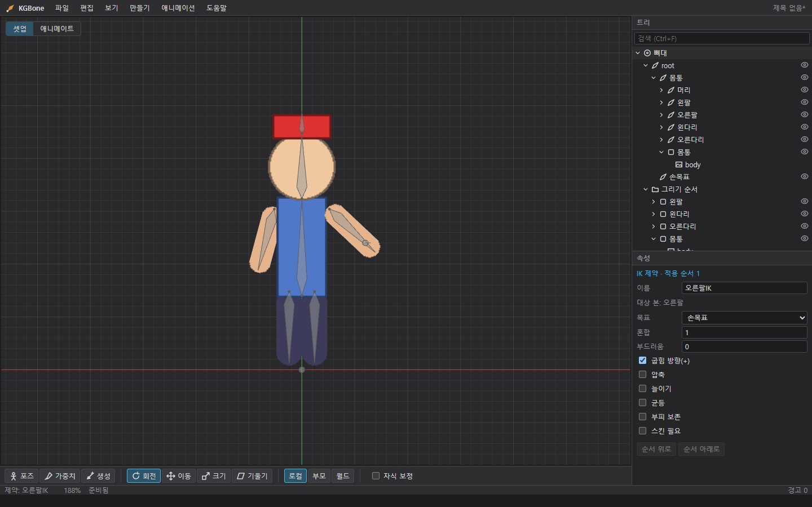

# 5. 제약

[← 4. 메시와 가중치](04-mesh.md) · [차례](README.md) · [다음: 6. 스킨과 이벤트 →](06-skins-events.md)

**제약**은 본을 직접 움직이지 않고 규칙으로 움직이게 합니다. 예를 들어 IK는 "손끝이 이 점에 닿도록 팔을 알아서 굽혀라"는 규칙입니다.

## 5-1. 제약 만들기 공통

1. 본을 순서대로 고릅니다(**Ctrl**+클릭). 종류마다 무엇을 어떤 순서로 고르는지는 아래 표를 보세요.
2. **만들기 → 제약 →** 종류. 또는 트리의 본이나 **제약** 폴더를 오른쪽 클릭 → **제약 만들기: …**
3. 트리의 **제약** 폴더에 생기고, 속성 패널에서 나머지를 정합니다.

| 종류 | 먼저 고를 것 | 마지막으로 고를 것 |
|---|---|---|
| IK | 굽힐 본 1~2개(부모 → 자식 순) | 목표 본 |
| 트랜스폼 | 따라 움직일 본들 | 원본 본 |
| 패스 | 길을 따라 늘어설 본들 + 패스 첨부물이 든 슬롯 | — |
| 물리 | 흔들릴 본 1개 | — |
| 슬라이더 | (선택) 슬라이더를 조종할 본 1개. 지금 고른 애니메이션이 연결됩니다 | — |

고르지 않고 만들어도 되고, 대상은 나중에 속성 패널에서 바꿀 수 있습니다.

### 모든 제약의 공통 항목

- **혼합**(0~1): 제약을 얼마나 적용할지. 0이면 꺼진 것과 같습니다. 애니메이트 모드에서 바꾸면 키가 됩니다(예: 칼을 쥘 때만 IK 켜기).
- **스킨 필요**: 켜면 이 제약을 넣은 스킨이 켜졌을 때만 동작합니다([6장](06-skins-events.md)).
- **순서 위로 / 순서 아래로**: 제약은 위에서부터 차례로 적용됩니다. 한 제약의 결과를 다른 제약이 써야 하면 순서를 맞춥니다. 속성 패널 맨 위에 **적용 순서**가 표시됩니다.

## 5-2. IK

굽힐 본의 끝이 **목표 본**에 닿도록 회전시킵니다. 본 1개면 목표를 바라보고, 본 2개(위팔·아래팔, 허벅지·종아리)면 관절을 굽혀 닿습니다.

위 그림은 `오른팔`에 1본 IK를 걸고, 목표 본 `손목표`를 팔 옆에 둔 모습입니다. 이제 `손목표`만 옮기면 팔이 따라 돕니다.

| 항목 | 뜻 |
|---|---|
| 목표 | 끝이 닿을 본 |
| 혼합 | 0~1 |
| 부드러움 | 팔을 다 폈을 때 툭 펴지지 않도록 부드럽게 하는 거리 |
| 굽힘 방향(+) | 2본 IK에서 관절이 굽는 방향. 끄면 반대로 굽습니다 |
| 압축 | 목표가 가까우면 본을 줄여서 맞춤 |
| 늘이기 | 목표가 멀면 본을 늘여서 닿음 |
| 균등 | 늘이기·압축 때 가로세로 같은 비율로 |
| 부피 보존 | 늘일 때 두께를 줄여 부피를 유지 |

> 팁: 목표 본은 굽힐 본의 자식이 아닌 곳(보통 `root`나 몸통)에 둡니다. 자식에 두면 서로 따라 움직여 계산이 맞지 않습니다.

## 5-3. 트랜스폼

따라 움직일 본들이 **원본 본**의 회전·이동·크기·기울기를 따라 하게 합니다. 기어·바퀴가 같이 돌거나, 한 본으로 여러 본을 함께 조종할 때 씁니다.

| 항목 | 뜻 |
|---|---|
| 원본 | 따라 할 본 |
| 로컬 원본 / 로컬 대상 | 켜면 화면 좌표가 아니라 부모 기준 값으로 따라 합니다 |
| 더하기 | 대상의 값을 원본 값으로 바꾸지 않고 더합니다 |
| 범위 제한 | 매핑 결과가 최대값을 넘지 않게 |
| 혼합 회전 / X / Y / 크기 X / 크기 Y / 기울기 Y | 항목별로 얼마나 따라 할지(0~1) |
| 속성 매핑 | "원본의 무엇이 대상의 무엇을 얼마나" 바꾸는지 직접 정하는 표. **원본** 속성과 오프셋, **대상** 속성과 오프셋, **최대**, **배율**. **매핑 추가**로 줄을 늘립니다(예: 원본 회전 → 대상 이동 X) |

## 5-4. 패스

본들을 **패스 첨부물**(곡선) 위에 늘어세웁니다. 기차·뱀·끈처럼 길을 따라가는 움직임에 씁니다. 먼저 [4장](04-mesh.md#4-6-그-밖의-첨부물)대로 패스 첨부물을 만들어 두세요.

| 항목 | 뜻 |
|---|---|
| 패스 슬롯 | 패스 첨부물이 든 슬롯 |
| 위치 방식 | 위치를 **고정**(길이 단위)으로 셀지 **비율**(0~1)로 셀지 |
| 위치 | 길 위의 시작 위치. 애니메이션하면 본들이 길을 따라 미끄러집니다 |
| 간격 방식 | 본 사이 간격: **길이**(본 길이만큼), **고정**, **비율**, **비례** |
| 간격 | 간격 값 |
| 회전 방식 | **접선**(길 방향을 봄), **사슬**(앞 본을 봄), **사슬+크기**(사슬 + 길이에 맞게 늘임) |
| 회전 보정 | 회전에 더할 각도 |
| 혼합 회전 / X / Y | 0~1 |

## 5-5. 물리

본이 관성·탄성·중력에 따라 **흔들리게** 합니다. 머리카락, 꼬리, 귀걸이, 옷자락에 씁니다. 재생 중에 계산되므로 키를 일일이 만들 필요가 없습니다.

| 항목 | 뜻 |
|---|---|
| 본 | 흔들릴 본 |
| 이동 X / 이동 Y / 회전 / 크기 X / 기울기 X | 어떤 움직임에 물리를 적용할지(0~1) |
| 관성 | 부모가 움직일 때 늦게 따라오는 정도 |
| 강도 | 원래 자세로 돌아가려는 힘(탄성) |
| 감쇠 | 흔들림이 줄어드는 정도. 클수록 빨리 멈춥니다 |
| 질량 | 무거울수록 천천히 크게 흔들립니다 |
| 바람 / 중력 | 계속 미는 힘. 바람은 가로, 중력은 세로 방향 |
| 속도 제한 | 너무 빠르게 튀지 않도록 하는 상한 |
| 초당 단계 | 1초에 몇 번 계산할지. 높을수록 정확하지만 무겁습니다 |
| 혼합 | 0~1 |
| 부피 보존 | 늘어날 때 두께를 줄임 |

물리의 거리 단위는 뼈대 속성의 **기준 배율**(기본 100)을 따릅니다. 캐릭터를 아주 크거나 작게 그렸다면 이 값을 맞추세요. 물리는 **재생할 때** 움직이므로 확인은 **D**로 재생하며 합니다.

## 5-6. 슬라이더

본 하나의 값(예: 손잡이 본의 위치)으로 **애니메이션 하나의 시점**을 조종합니다. "손잡이를 오른쪽으로 끌면 표정이 웃는 얼굴로 바뀜"처럼 다이얼로 쓰는 애니메이션을 만들 때 씁니다.

| 항목 | 뜻 |
|---|---|
| 애니메이션 | 조종할 애니메이션 |
| 시점 | 본을 쓰지 않을 때의 시점 |
| 반복 | 시점이 끝을 넘으면 처음으로 이어서 |
| 더하기 | 그 애니메이션을 지금 자세에 더해서 적용 |
| 혼합 | 0~1 |
| 본 / 속성 | 조종할 본과 그 본의 어떤 값(회전, 이동 X·Y, 크기 X·Y, 기울기 Y)을 쓸지 |
| 범위 시작 / 범위 끝 | 그 값이 이 범위를 지날 때 애니메이션이 처음부터 끝까지 진행됩니다 |
| 로컬 값 | 켜면 부모 기준 값을 씁니다 |

> 슬라이더 제약은 `.kgbone`에는 저장되지만 Spine JSON 호환 내보내기에서는 빠집니다([7장](07-files-export.md)).

## 5-7. 제약 결과를 키로 굽기

애니메이트 모드에서 본을 고르고 **Shift+K**(제약 적용 값 키 지정)를 누르면, 제약이 만든 지금 자세를 그 본의 일반 키로 넣습니다. 제약을 끈 뒤에도 같은 자세를 유지하고 싶을 때 씁니다.

---
[← 4. 메시와 가중치](04-mesh.md) · [차례](README.md) · [다음: 6. 스킨과 이벤트 →](06-skins-events.md)
