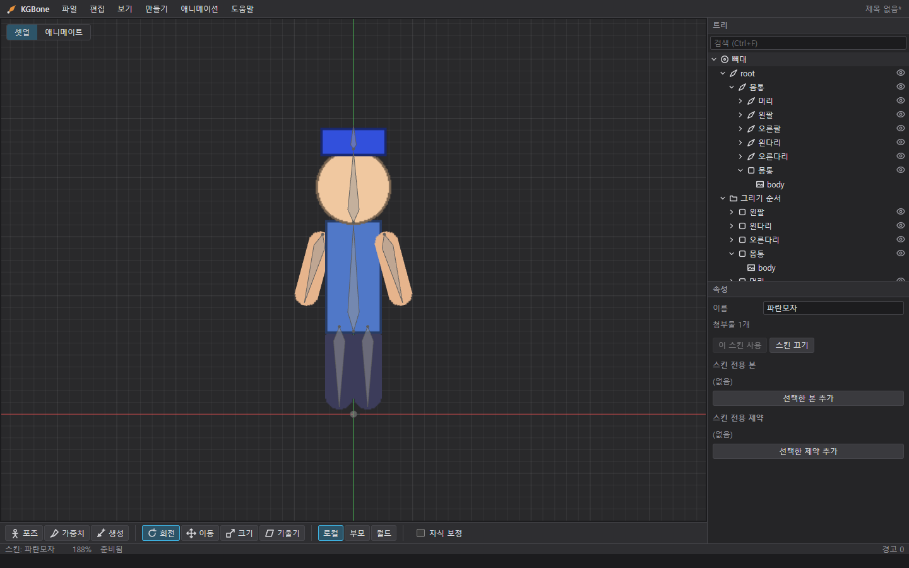
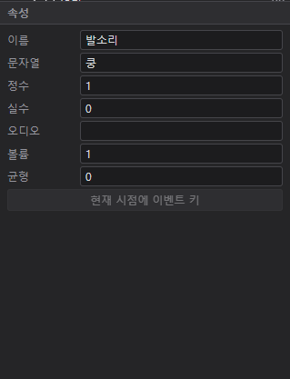

# 6. 스킨과 이벤트

[← 5. 제약](05-constraints.md) · [차례](README.md) · [다음: 7. 파일과 내보내기 →](07-files-export.md)

## 6-1. 스킨

**스킨**은 같은 뼈대와 애니메이션에 **다른 그림 세트**를 끼우는 기능입니다. 옷, 무기, 머리 모양, 색 변형 캐릭터를 하나의 프로젝트에서 관리합니다.

### 스킨이 그림을 고르는 방식

첨부물은 **슬롯 이름 + 첨부물 이름**으로 찾습니다. 모든 프로젝트에는 `default` 스킨이 있고, 다른 스킨을 켜면:

1. 켠 스킨에 **같은 슬롯·같은 이름**의 첨부물이 있으면 그것을 씁니다.
2. 없으면 `default` 스킨의 것을 씁니다.

그래서 바꿔 끼울 파츠는 **첨부물 이름을 그림 이름이 아닌 역할 이름**으로 짓는 것이 요령입니다. 예제 인형은 모자 슬롯의 첨부물 이름을 `모자`로 하고, 그림은 **경로**로 지정했습니다.

| 스킨 | 슬롯 | 첨부물 이름 | 경로(그림) |
|---|---|---|---|
| default | 모자 | 모자 | hat-red |
| 파란모자 | 모자 | 모자 | hat-blue |

### 따라 하기: 파란 모자 스킨

1. **만들기 → 스킨**으로 스킨을 만들고 이름을 `파란모자`로 바꿉니다.
2. 트리에서 스킨을 오른쪽 클릭 → **이 스킨 사용**(또는 속성 패널의 **이 스킨 사용**). 이제 새로 만드는 첨부물은 이 스킨에 들어갑니다.
3. `모자` 슬롯을 고르고 **만들기 → 첨부물 → 이미지** → `hat-blue`.
4. 새 첨부물의 이름을 `모자`로 바꿉니다(default의 첨부물과 같은 이름). 속성의 **경로**가 `hat-blue`인지 확인합니다.
5. 위치·회전을 default의 모자와 같게 맞춥니다(예제: 위치 X `6`, 회전 `-90`).

스킨을 바꿔 가며 확인하려면 스킨을 고르고 **이 스킨 사용** / **스킨 끄기**를 누릅니다. 스킨을 끄면 `default`만 보입니다. 속성 패널에는 그 스킨에 든 첨부물 수가 표시됩니다.

### 스킨 전용 본과 제약

특정 스킨에서만 필요한 본(예: 망토 스킨의 망토 본)과 제약은 **스킨 전용**으로 만들 수 있습니다.

1. 본(또는 제약) 속성의 **스킨 필요**를 켭니다.
2. 스킨 속성에서 그 본을 Ctrl+클릭으로 함께 고르고 **선택한 본 추가**(제약은 **선택한 제약 추가**)를 누릅니다. 목록의 **빼기**로 다시 뺍니다.

이제 그 스킨이 켜졌을 때만 본과 제약이 동작합니다.

## 6-2. 이벤트

**이벤트**는 애니메이션의 특정 시점에 게임에 보내는 **신호**입니다. 발소리, 칼 휘두르는 소리, 공격 판정, 효과 터뜨리기 같은 일을 게임 코드가 그 신호를 받아 처리합니다. 화면에는 아무것도 그리지 않습니다.

### 이벤트 만들기

1. **만들기 → 이벤트**. 트리의 **이벤트** 폴더에 생깁니다. 이름을 `발소리`처럼 바꿉니다.
2. 속성 패널에서 기본값을 정합니다.

| 항목 | 뜻 |
|---|---|
| 문자열 / 정수 / 실수 | 게임에 함께 보낼 값(예: 소리 이름, 피해량) |
| 오디오 | 소리 파일 경로(게임 쪽에서 씀) |
| 볼륨 / 균형 | 소리 크기(0~1)와 좌우(-1~1) |

### 애니메이션에 이벤트 키 넣기

1. 애니메이트 모드에서 이벤트를 넣을 애니메이션과 시점을 고릅니다.
2. 트리에서 이벤트를 고르고 속성 패널의 **현재 시점에 이벤트 키**를 누릅니다.

도프시트에 이벤트 줄이 생기고 키가 표시됩니다. 다른 키처럼 끌어서 옮기거나 지울 수 있습니다.

> 유니티 런타임은 이 이벤트를 `EventFired`로 알려 줍니다([unity/com.kgbone.runtime/README.md](../unity/com.kgbone.runtime/README.md)).

---
[← 5. 제약](05-constraints.md) · [차례](README.md) · [다음: 7. 파일과 내보내기 →](07-files-export.md)
