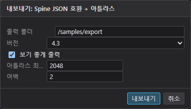
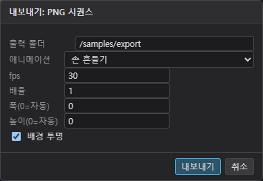

# 7. 파일과 내보내기

[← 6. 스킨과 이벤트](06-skins-events.md) · [차례](README.md) · [다음: 8. 참고표 →](08-reference.md)

## 7-1. 프로젝트 파일(.kgbone)

| 메뉴 | 키 | 동작 |
|---|---|---|
| 파일 → 새로 만들기 | Ctrl+N | 빈 프로젝트(본 `root` 하나) |
| 파일 → 열기… | Ctrl+O | `.kgbone` 열기 |
| 파일 → 저장 | Ctrl+S | 저장. 처음이면 이름을 묻습니다 |
| 파일 → 다른 이름으로 저장… | Ctrl+Shift+S | 새 이름·새 위치로 저장 |

- `.kgbone`은 사람이 읽을 수 있는 JSON 파일입니다. 형식은 [docs/FORMAT.md](../docs/FORMAT.md)에 있습니다.
- 아무것도 고치지 않고 저장하면 파일이 **한 글자도 바뀌지 않습니다**. 고친 부분만 바뀌므로 Git 같은 버전 관리로 변경 내용을 보기 쉽습니다.
- 뼈대·애니메이션과 함께 **작업 상태**(고른 애니메이션과 시점, 모드, 화면 위치·확대, 오니언 스킨 설정)도 저장되어, 다시 열면 하던 화면 그대로 이어집니다.
- 저장하지 않은 변경이 있을 때 새로 만들기·열기·닫기를 하면 **저장 / 저장 안 함 / 취소**를 묻습니다.
- 설치한 웹 앱에서는 `.kgbone` 파일을 더블클릭해서도 열 수 있습니다([1장](01-start.md#kgbone-파일을-더블클릭으로-열기)).

## 7-2. 이미지 폴더

그림은 프로젝트 파일 안에 들어가지 않습니다. 프로젝트는 **이미지 폴더 경로**만 기억하고, 열 때마다 그 폴더의 PNG를 읽습니다.

- 경로는 **프로젝트 파일이 있는 폴더 기준**입니다. 기본값은 `./images`.
- 바꾸려면 **파일 → 이미지 폴더 지정…** 또는 트리의 **뼈대**를 고르고 속성 패널의 **이미지 폴더**에 입력합니다.
- 그림을 고쳤으면 **파일 → 이미지 다시 불러오기**(F5).
- 첨부물의 그림 이름은 이미지 폴더 기준 경로에서 `.png`를 뺀 것입니다(`images/옷/윗옷.png` → `옷/윗옷`).
- 그림을 못 찾으면 그 첨부물은 그려지지 않습니다. 이름과 폴더를 확인하세요.

### 웹 앱에서 폴더를 고르라고 할 때

웹 앱은 보안상 **사용자가 고른 폴더 안에서만** 파일을 읽고 쓸 수 있습니다. 그래서 프로젝트를 열 때 **프로젝트 폴더 고르기** 창이 뜨면 **`.kgbone` 파일이 있는 폴더(또는 그 위 폴더)**를 고르세요. 그 안에 있는 `images` 폴더까지 함께 읽힙니다. 앱을 켜 둔 동안에는 같은 폴더 안의 파일을 열 때 다시 묻지 않습니다(앱을 다시 켜면 처음 열 때 한 번 더 묻습니다).

## 7-3. Spine JSON 호환 가져오기

**파일 → 가져오기 → Spine JSON 호환(.json)…**(Ctrl+I)으로 Spine 4.2 / 4.3 형식의 JSON을 엽니다.

- 가져온 내용은 새 문서(제목 없음)로 열립니다. 저장하면 `.kgbone`이 됩니다.
- 그림은 JSON 파일이 있는 폴더를 기준으로 찾습니다. 그림이 안 보이면 **이미지 폴더 지정**으로 그림 폴더를 고르세요.
- KGBone이 모르는 필드는 버리지 않고 보관했다가 내보낼 때 그대로 돌려놓습니다.
- 읽으면서 확인할 것이 있으면 **가져오기 경고** 창에 목록이 나옵니다.

## 7-4. Spine JSON 호환 + 아틀라스 내보내기

**파일 → 내보내기 → Spine JSON 호환 + 아틀라스…**(Ctrl+E). 다른 도구나 Spine 형식을 읽는 게임 런타임에서 쓸 수 있는 파일 묶음을 만듭니다.

| 항목 | 뜻 |
|---|---|
| 출력 폴더 | 파일을 쓸 폴더(기본: 프로젝트 옆 `export`) |
| 버전 | 4.3 또는 4.2 형식 |
| 보기 좋게 출력 | 들여쓰기·줄바꿈을 넣어 사람이 읽기 쉽게 |
| 아틀라스 최대 크기 / 여백 | 텍스처 한 장의 최대 크기와 그림 사이 여백 |

만들어지는 파일(프로젝트 이름이 `인형`이면):

| 파일 | 내용 |
|---|---|
| `인형.json` | 뼈대·스킨·애니메이션 |
| `인형.atlas` | 텍스처 안의 그림 위치 |
| `인형.png`(많으면 `인형_2.png` …) | 파츠를 모아 붙인 텍스처 |

끝나면 쓴 파일 목록과 경고가 나옵니다. 경고는 Spine 형식으로 옮기지 못한 것(예: 슬라이더 제약, 부피 보존 옵션)입니다. 그런 기능도 `.kgbone`에는 모두 저장됩니다.

> 지금은 **아틀라스 최대 크기**와 **여백** 값이 반영되지 않고 기본값(최대 2048, 여백 2)으로 만들어집니다.

## 7-5. PNG 시퀀스 내보내기

**파일 → 내보내기 → PNG 시퀀스…**. 애니메이션을 프레임마다 PNG 한 장으로 그립니다. 스프라이트 애니메이션만 지원하는 엔진, 영상 편집, 미리보기 공유에 씁니다.

| 항목 | 뜻 |
|---|---|
| 출력 폴더 | 기본: 프로젝트 옆 `export` |
| 애니메이션 | 그릴 애니메이션. **(셋업 포즈)**면 한 장 |
| fps | 1초에 몇 장 그릴지 |
| 배율 | 크기 배율(2면 두 배 크기) |
| 폭 / 높이 | 그림 크기. 0이면 캐릭터에 맞춰 자동 |
| 배경 투명 | 배경을 투명하게 |

- 파일 이름은 `인형_0000.png`, `인형_0001.png` … 입니다.
- 지금 켠 스킨으로 그립니다.
- 지금은 **배경 투명** 선택이 반영되지 않고 항상 투명 배경으로 그립니다.

## 7-6. 유니티에서 재생하기

`.kgbone`을 유니티(Unity 6 이상, URP)에서 KGBone과 같은 결과로 재생하는 패키지가 있습니다. 내보내기 없이 `.kgbone`과 `images` 폴더를 그대로 `Assets`에 넣으면 됩니다.

1. Package Manager → **+** → **Add package from git URL** →
   `https://github.com/dudwo2199/KGBone.git?path=/unity/com.kgbone.runtime#main`
2. `.kgbone`과 그 `images` 폴더를 함께 `Assets` 아래에 넣습니다. 텍스처·머티리얼이 자동으로 만들어집니다.
3. 빈 GameObject에 **KGBoneAnimation**을 붙이고 데이터와 애니메이션을 고릅니다.
4. KGBone에서 고쳐 저장한 파일로 덮어쓰면 유니티에 바로 반영됩니다.

지금은 재생과 본 위치 읽기까지 됩니다(제약·클리핑·시퀀스·애니메이션 섞기는 아직 없음). 자세한 사용법: [unity/com.kgbone.runtime/README.md](../unity/com.kgbone.runtime/README.md)

---
[← 6. 스킨과 이벤트](06-skins-events.md) · [차례](README.md) · [다음: 8. 참고표 →](08-reference.md)
