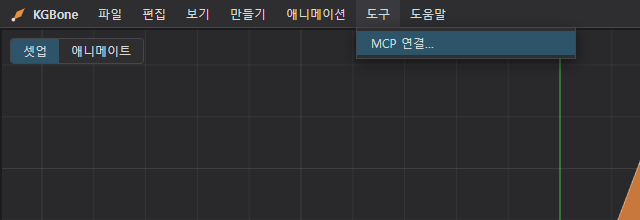
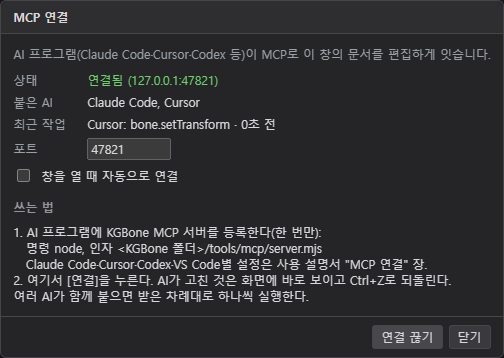
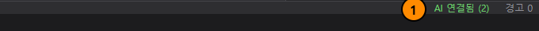
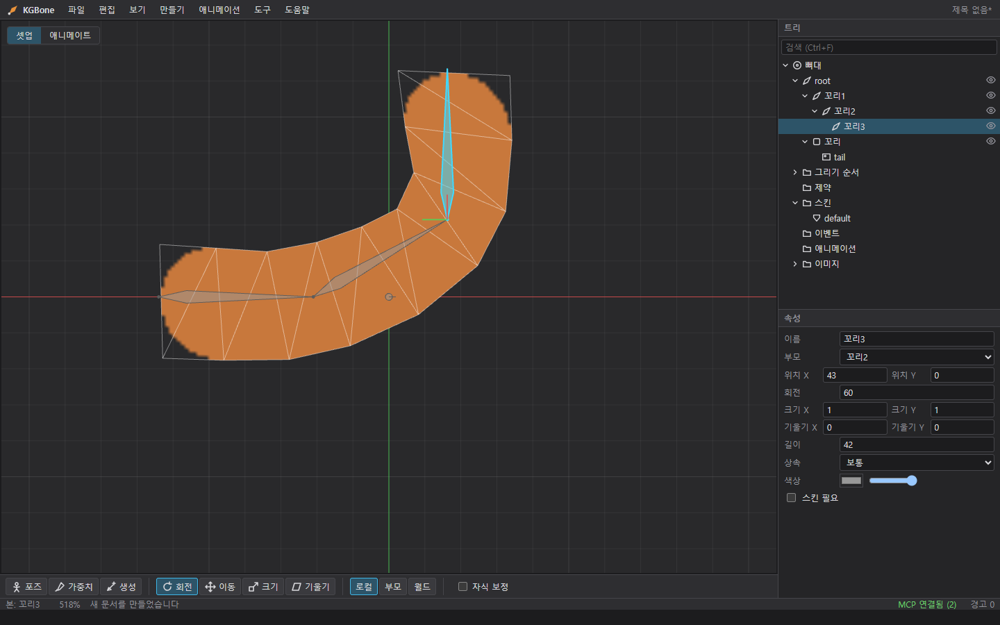

# 9. MCP 연결

[← 8. 참고표](08-reference.md) · [차례](README.md)

AI 프로그램(Claude Code, Claude 데스크톱, Cursor, Codex, VS Code의 Copilot, Gemini CLI 등)에게 "팔 본을 하나 더 만들고 손 흔드는 애니메이션을 넣어 줘"처럼 말로 시켜서, **열어 둔 KGBone 창의 문서**를 고치게 할 수 있습니다.
AI가 고친 것은 화면에 바로 보이고, 내가 손으로 고친 것과 같은 되돌리기 기록에 쌓여 Ctrl+Z로 되돌릴 수 있습니다.

연결에는 [MCP](https://modelcontextprotocol.io)라는 공개 표준을 씁니다. MCP를 지원하는 AI 프로그램이면 어느 것이든 됩니다.

## 9-1. 준비: AI 프로그램에 KGBone MCP 서버 등록(한 번만)

KGBone MCP 서버는 Node.js로 도는 작은 프로그램입니다(`tools/mcp/server.mjs`). 필요한 것:

- Node.js 22 이상
- KGBone MCP 서버 파일: [GitHub 릴리스](https://github.com/dudwo2199/KGBone/releases)에서 `kgbone-mcp-<버전>.zip`을 받아 원하는 곳에 풉니다(안의 폴더 구조는 그대로). 아래 예시의 `D:/KGBone`은 푼 폴더(`…/kgbone-mcp`)로 바꿉니다.
  - 저장소를 받아 쓴다면 `tools/mcp/`, `interface/commands.json`, `app/public/kgbone.wasm`이 같은 역할입니다(`kgbone.wasm`은 `npm run wasm` 또는 `npm run wasm:fetch`).

AI 프로그램마다 설정 파일에 아래처럼 적습니다. `D:/KGBone`은 KGBone 폴더, `D:/내작업`은 AI가 파일을 읽고 쓸 폴더로 바꿉니다.

| AI 프로그램 | 설정 파일 |
|---|---|
| Claude Code | 작업 폴더의 `.mcp.json` (KGBone 저장소 안에서 열면 이미 등록돼 있음) |
| Claude 데스크톱 | 설정 → 개발자 → 설정 편집(`claude_desktop_config.json`) |
| Cursor | 작업 폴더의 `.cursor/mcp.json` 또는 `~/.cursor/mcp.json` |
| Gemini CLI | `~/.gemini/settings.json` |

```json
{
  "mcpServers": {
    "kgbone": {
      "command": "node",
      "args": ["D:/KGBone/tools/mcp/server.mjs"],
      "env": { "KGBONE_MCP_ROOTS": "D:/내작업" }
    }
  }
}
```

VS Code(Copilot)는 작업 폴더의 `.vscode/mcp.json`에 `servers`로 적습니다.

```json
{
  "servers": {
    "kgbone": { "type": "stdio", "command": "node", "args": ["D:/KGBone/tools/mcp/server.mjs"], "env": { "KGBONE_MCP_ROOTS": "D:/내작업" } }
  }
}
```

Codex(CLI·IDE 확장)는 `~/.codex/config.toml`에 적습니다.

```toml
[mcp_servers.kgbone]
command = "node"
args = ["D:/KGBone/tools/mcp/server.mjs"]
env = { KGBONE_MCP_ROOTS = "D:/내작업" }
```

- 파일은 서버를 띄운 폴더와 `KGBONE_MCP_ROOTS`에 적은 폴더(여러 개면 `;`로 구분) 안에서만 읽고 씁니다.
- 창 연결 없이(창을 열지 않고) 쓰면 AI는 서버 안에서 창 없는 문서를 고칩니다. 결과는 `.kgbone`으로 저장해 나중에 KGBone에서 엽니다.

## 9-2. 창 잇기

1. AI 프로그램을 켭니다(그러면 KGBone MCP 서버가 함께 켜집니다).
2. KGBone에서 **도구 → MCP 연결…** 을 누르고 **[연결]** 을 누릅니다.

   

3. 상태가 "연결됨"이 되고 "붙은 AI"에 AI 프로그램 이름이 나오면 됩니다. 상태 표시줄 오른쪽에도 "MCP 연결됨"이 보입니다(괄호 안은 붙은 AI 수, 누르면 이 대화상자가 열립니다).






| 칸 | 뜻 |
|---|---|
| 상태 | 꺼짐 / 연결하는 중 / 연결됨 / AI 프로그램을 기다리는 중(AI 프로그램이 아직 안 켜졌으면 켜질 때 저절로 붙습니다) |
| 붙은 AI | 지금 이 창을 쓰는 AI 프로그램 이름 |
| 최근 작업 | 마지막으로 AI가 시킨 일(명령 id)과 성공 여부 |
| 포트 | 연결할 번호(기본 47821). MCP 서버의 환경 변수 `KGBONE_MCP_PORT`와 같아야 합니다 |
| 창을 열 때 자동으로 연결 | 켜 두면 다음부터 [연결]을 누르지 않아도 됩니다 |

## 9-3. 연결되면 AI가 할 수 있는 것



- 창에 열린 문서를 편집합니다(본·슬롯·첨부물·제약·키 등 모든 편집 명령).
- 화면 명령(선택, 화면 맞춤, 모드 전환, 재생 등)도 실행합니다.
- 이 PC의 파일을 열고 저장합니다. AI가 연 파일은 창 제목에 이름이 나오고, 그 뒤 창에서 Ctrl+S를 눌러도 같은 파일에 저장됩니다. 이미지 폴더도 MCP 연결을 거쳐 읽습니다.
- 뷰포트를 그림으로 찍어(본·선택 표시 포함) 결과를 눈으로 확인합니다.
- 대화상자를 여는 명령(단축키 목록, 이미지를 고르는 창 등)은 AI가 부르면 바로 닫히고 실행되지 않습니다. 대화상자로 고르는 것은 직접 하시거나, AI에게 이름을 정해 달라고 하면 됩니다.
- 작업 중에 창 연결이 끊기면 AI가 다음에 시키는 일은 실행되지 않고 "창 연결이 끊겼다"고 AI에게 알려집니다. 모르는 채 다른 문서를 고치지 않게 하려는 것입니다.
- 저장하지 않은 변경이 있을 때 AI가 새 문서·다른 파일을 열려고 하면, 창에 "저장할까요?"가 뜹니다. [취소]하면 AI에게 "사용자가 취소했습니다"라고 전해집니다.

## 9-4. 여러 AI를 함께 쓸 때

- Cursor와 Claude Code처럼 AI 프로그램 여러 개가 동시에 켜져 있어도 됩니다. 먼저 켜진 쪽의 MCP 서버가 연결 창구(중계소)를 열고, 나중 것은 그 창구를 거쳐 같은 창에 붙습니다. 먼저 켜진 쪽을 끄면 남은 쪽이 창구를 이어받고, 창은 몇 초 안에 다시 붙습니다.
- 여러 AI가 시킨 일은 받은 차례대로 하나씩 실행되고, 되돌리기 기록에도 그 순서로 쌓입니다.
- MCP 연결은 한 번에 창 하나만 씁니다. 다른 KGBone 창에서 [연결]을 누르면 그 창이 연결을 가져가고 앞 창의 연결은 끊깁니다.
- "창을 열 때 자동으로 연결"이나 다시 붙기는 이미 연결된 창을 밀어내지 않습니다. 이때 상태는 "다른 KGBone 창이 연결돼 있어 기다리는 중"이고, 그 창이 닫히거나 연결을 끊으면 저절로 이어받습니다.

## 9-5. 안전

- 연결 창구는 이 PC 안(127.0.0.1)에서만 열리고, 다른 컴퓨터에서는 붙을 수 없습니다.
- 웹 페이지는 KGBone 화면 주소(이 PC의 `localhost`·`127.0.0.1`, 설치형 웹 앱 주소 `https://dudwo2199.github.io`, 실행 파일 판)에서 온 것만 받습니다. 다른 웹사이트가 몰래 붙는 것을 막습니다. 다른 주소에 올린 KGBone을 쓰려면 MCP 서버 환경 변수 `KGBONE_MCP_ORIGINS`에 그 주소를 적습니다.
- 창 연결을 아예 끄려면 MCP 서버 환경 변수 `KGBONE_MCP_LIVE=0`.
- 설치형 웹 앱(https 주소)에서 처음 연결할 때 브라우저가 "이 사이트가 로컬 네트워크의 기기에 접근하려고 합니다" 같은 허용 여부를 물을 수 있습니다. 허용해야 연결됩니다.
