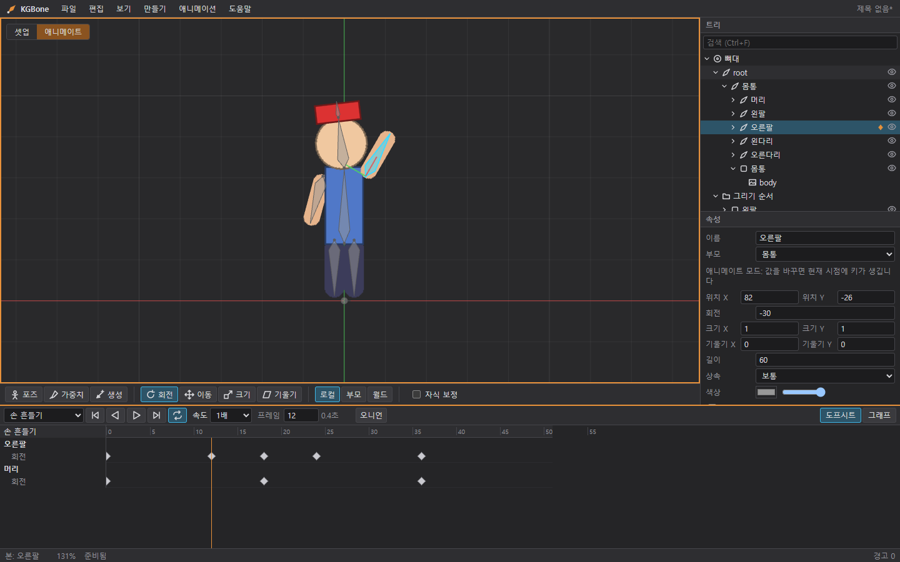

# KGBone 사용 설명서

KGBone은 그림 파츠를 본(뼈)에 붙이고, 본을 움직여 2D 애니메이션을 만드는 에디터입니다.
이 설명서는 설치부터 캐릭터 만들기, 애니메이션, 내보내기까지 순서대로 안내합니다.

## 차례

| 장 | 내용 |
|---|---|
| [1. 설치와 화면 구성](01-start.md) | 웹 앱 설치, `.kgbone` 파일 연결, 화면 각 부분의 이름 |
| [2. 첫 캐릭터 만들기](02-first-character.md) | 프로젝트 폴더 준비, 본 만들기, 그림 붙이기, 위치·그리기 순서 맞추기, 저장 |
| [3. 애니메이션](03-animation.md) | 셋업/애니메이트 모드, 키 만들기, 재생, 도프시트, 그래프, 오니언 스킨 |
| [4. 메시와 가중치](04-mesh.md) | 그림을 휘게 만드는 메시, 정점 편집, 바인딩, 자동 가중치, 가중치 붓 |
| [5. 제약](05-constraints.md) | IK, 트랜스폼, 패스, 물리, 슬라이더 |
| [6. 스킨과 이벤트](06-skins-events.md) | 옷·장비 바꿔 끼우기, 소리·효과 신호 |
| [7. 파일과 내보내기](07-files-export.md) | 저장·열기, 이미지 폴더, Spine JSON 호환 내보내기, PNG 시퀀스, 유니티 |
| [8. 참고표](08-reference.md) | 단축키 전체, 마우스 조작, 숫자 입력칸 수식, 자주 묻는 것 |

## 처음이라면

1. [1장](01-start.md)대로 웹 앱을 설치합니다.
2. [2장](02-first-character.md)의 예제 인형을 따라 만들어 봅니다. 10분 정도 걸립니다.
3. [3장](03-animation.md)에서 그 인형으로 손 흔드는 애니메이션을 만듭니다.

이 설명서의 그림은 저장소의 시험 이미지(`samples/images`)로 만든 예제 인형입니다. 스크린샷은 `node tools/manual-shots.mjs`(개발 서버를 띄운 상태)로 다시 찍을 수 있습니다.
